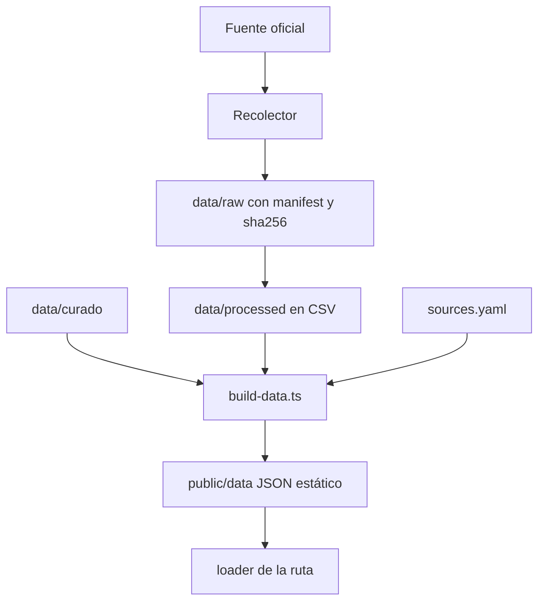

# Vitrina

**Propósito del producto (pendiente del equipo).** Este repositorio se acaba de crear y todavía no define a quién le sirve ni qué problema resuelve. Reemplazar este párrafo por: para quién es Vitrina, qué hace, qué queda fuera y el enlace al sitio cuando exista.

El stack, los comandos, la estructura y las convenciones de esta guía salen de [mendoza-transparente](https://github.com/unllamas/mendoza-transparente), el proyecto de referencia del mismo equipo. **Vitrina no tiene código de aplicación**: no hay `package.json`, apps ni datos. Lo que sigue es el estándar a copiar cuando se arme el monorepo. Los comandos de abajo **no corren en este repositorio** hasta que exista ese esqueleto; sí corren en el referente.

La guía para agentes está en [`AGENTS.md`](AGENTS.md). El detalle operativo está en las skills de [`.cursor/skills/`](.cursor/skills/).

## Stack

Monorepo en TypeScript estricto, con workspaces de Bun y Turborepo. La interfaz es una app estática (Vite + React) publicada en Cloudflare Pages. No hay Redux, Zustand ni otro store global: lo que alguien querría compartir vive en la URL, y los datos de cada página se calculan en el build y se piden en el `loader` de la ruta.

| Pieza | Versión en el referente | Para qué |
|---|---|---|
| [Bun](https://bun.sh) | `1.4.2` (`packageManager`) | Instalar, correr TypeScript directo y las pruebas (`bun test`) |
| TypeScript | `^5` en la raíz; `^7` como devDependency de `packages/ui` | `strict` y `noUncheckedIndexedAccess`. En la web y en la UI, además `noUnusedLocals` |
| Turborepo | `^2` | `dev`, `build` y `typecheck` por paquete |
| React | `^19.3.0` | UI |
| Vite | `^8.3.4` | Dev server y build de cada app |
| TanStack Router | `^1.170.42` | Rutas escritas en código (`apps/web/src/main.tsx`), no file-based |
| Tailwind CSS | `^4.3.3` (`@tailwindcss/vite`) | Única forma de estilar. Sin CSS de componente |
| React Aria | `react-aria-components` `^1.17.0` | Base accesible de los controles |
| BoardUI | código fuente dentro de `packages/ui` | Design system (botones, campos, tokens). Se suma con el CLI, no se editan `globals.css` / `theme.css` / `typography.css` a mano |
| Recharts | `^3.9.2` | Gráficos de serie (`apps/web/src/charts/`) |
| Remix Icon | `@remixicon/react` `^4.9.0` | Íconos, variantes `Line` |
| Biome | `2.5.15` | Formato y lint |
| dependency-cruiser | `^18.6.0` | Dirección de los imports |
| lefthook + commitlint | `^2.2.1` y `^21` | Hooks de commit y Conventional Commits |
| playwright-core | `^1.64.0` | Verificación visual (`bun run verificar`), no la suite de unidad |
| Cloudflare Pages + Functions + D1 | — | Sitio estático, API y base. El referente eligió Pages por tráfico estático sin tope y plan gratis |

Paquetes del referente, scope `@mt/*`: `@mt/web`, `@mt/ui`, `@mt/core`, `@mt/scrapers`, `@mt/participation`, más `@mt/assistant`, `@mt/mascots`, `@mt/panel`, `@mt/votacion` y `@mt/social`. Al crear Vitrina, conservar el corte (app / UI genérica / núcleo de datos / recolectores) y elegir un scope propio (`@vitrina/…`). No hace falta traer panel, votación, asistente ni piezas de redes hasta que el producto los pida.

## Prerrequisitos

- Bun 1.4.2.
- Git.
- Google Chrome, para la verificación visual. El script del referente usa `CHROME_PATH` o, si no está, la ruta de Chrome en macOS.

## Puesta en marcha

Hoy no hay dependencias que instalar. Cuando el monorepo exista, desde la raíz:

```bash
bun install
bun run hooks          # una vez por clon
bun run dev            # la web; en el referente, turbo --filter=@mt/web
```

En el referente `dev` de la web hace dos cosas: `bun run data` (arma `apps/web/public/data/` desde los CSV) y después Vite. Los datos procesados ya están en el repo, así que el sitio levanta sin correr recolectores. `public/data/` no se versiona.

Otros arranques del referente, por si más adelante hay más de una app:

```bash
bun run panel          # apps/panel
bun run votacion       # apps/votacion
bun run piezas         # apps/social, solo local
```

## Variables de entorno

Solo los **nombres**. Los valores no van en el repositorio ni en este archivo. En el referente, lo público del build de producción está en `apps/web/.env.production` (queda en el JavaScript) y lo secreto vive en Cloudflare o en archivos ignorados.

Públicas, prefijo `VITE_` (las lee el cliente):

| Nombre | Dónde se usa en el referente |
|---|---|
| `VITE_SITE_URL` | Dominio canónico (`apps/web/src/seo.ts`). Sin barra final |
| `VITE_POSTHOG_KEY` | Analítica. Sin clave no se carga PostHog |
| `VITE_POSTHOG_HOST` | Host de PostHog. Si falta, `https://us.i.posthog.com` |
| `VITE_TURNSTILE_SITE_KEY` | Widget anti-spam. Sin clave, el campo se muestra igual |
| `VITE_TRACK_DEBUG` | Solo desarrollo: imprime cada evento en la consola |
| `VITE_AGENTATION_ENDPOINT` | Solo desarrollo, en `apps/web/.env.local` |

Secretos de las funciones y de los recolectores (nunca en un archivo con `VITE_`):

| Nombre | Para qué |
|---|---|
| `TURNSTILE_SECRET` | Verificar el widget en la función |
| `IP_SALT` | Hashear la IP antes de guardarla |
| `PROXY_AR` | Proxy con salida en Argentina para hosts que rechazan la nube |
| `AI_GATEWAY_API_KEY` | Proveedor del asistente |
| `OPENROUTER_API_KEY` | Proveedor de respaldo del asistente |
| `ASSISTANT_PROVIDERS` | Orden de proveedores (`gateway,openrouter` si falta) |
| `ASSISTANT_MODEL` | Modelo por defecto |
| `ASSISTANT_MODEL_GATEWAY` | Modelo del gateway |
| `ASSISTANT_MODEL_OPENROUTER` | Modelo de OpenRouter |
| `ASSISTANT_MODEL_ANSWER` | Modelo del paso de respuesta |
| `ASSISTANT_MODEL_TOOLS` | Modelo del paso de herramientas |
| `ASSISTANT_TURNSTILE` | `on` exige el desafío en el asistente |
| `IA_ACCESS_KEY` | Clave S3 de archive.org |
| `IA_SECRET_KEY` | Secreto S3 de archive.org |
| `ANTHROPIC_API_KEY` | Resúmenes y la actualización manual |
| `MODELO_RESUMENES` | Modelo de esos resúmenes |

Archivos locales que el referente ignora y no se commitean: `.env`, `.env.local`, `.env.cloudflare`, `.env.posthog`, `.env.asistente`, `.env.archive-org`.

De herramientas (no son secretos del producto): `CHROME_PATH`, `MT_NO_DATA_WATCH`, `MT_VERIFY_PORT`, `MT_VITALS_PORT`, `MT_PREVIEW_PORT`, `MT_CRUDO_CACHE`, `TRIBUTOS_DEBUG`, `LRF_DRY_RUN`. El prefijo `MT_` es del referente: al copiar un script, renombrarlo en el mismo cambio.

## Estructura prevista

La del referente. Crear solo las carpetas que la primera entrega necesite.

```
apps/web/                 sitio (Vite + React + TanStack Router)
  src/pages/              una página por ruta
  src/features/<feature>/ api, components, hooks, utils de esa feature
  src/components/         UI de la web que conoce router, analítica o datos
  src/charts/             gráficos
  src/lib.ts              carga de JSON y formato
  src/types.ts            contratos de los JSON publicados
  src/url-state.ts        estado compartible en la query
  scripts/build-data.ts   CSV y catálogo → public/data/
  scripts/temas/          un agregado JSON por página temática
  functions/              Pages Functions (API)
packages/ui/              design system, sin router ni datos del sitio
packages/core/            descarga, archivo, CSV
packages/scrapers/        un recolector por fuente
data/raw/<id>/<fecha>/    originales, solo se agregan
data/processed/<id>/      CSV normalizados
data/curado/              lo escrito a mano
sources.yaml              catálogo de fuentes
```

Regla de dirección, controlada con dependency-cruiser: los paquetes no importan apps; la UI genérica no importa el router, PostHog ni los paquetes de datos; una página no importa otra página; la lógica sin interfaz (`lib.ts`, `types.ts`, `url-state.ts`) no importa componentes.

Imports dentro de `apps/web/src`: alias `@/` para todo lo que no está en el mismo directorio (`@/components/breadcrumbs.tsx`), archivos directos, sin `index.ts` que reexporte. Nombres de archivo en `kebab-case`.

## Modelo de datos

Cada número del referente se puede seguir hasta el archivo oficial. El recorrido es siempre el mismo:



1. **Catálogo.** `sources.yaml`: una entrada por fuente, con `id`, `nombre`, `descripcion`, `organismo`, `url`, `formato`, `frecuencia`, `dificultad` (`facil` | `media` | `dificil`) y `estado` (`pendiente` | `activo` | `roto`). El `id` es el nombre de la carpeta.
2. **Crudo.** `data/raw/<id>/<AAAA-MM-DD>/` guarda el archivo tal cual llegó. `manifest.jsonl` anota `filename`, `path`, `url`, `fetched_at`, `sha256`, `bytes` y `gzip`. Solo se agrega: no se edita ni se borra. Lo descarga `get()`, `archive()`, `fetchAndArchive()` o `fetchOrReuse()` de `@mt/core` (`packages/core/src/fetch.ts`), con User-Agent de navegador, reintentos y una pausa de 500 ms. Por encima de 1 MB se comprime. HTML se compara por el texto visible (`huella()`), no por bytes que cambian en cada visita.
3. **Normalizado.** `data/processed/<id>/<archivo>.csv`, UTF-8, columnas en `snake_case` español, montos en pesos nominales. Al lado, `<archivo>.meta.json` (diccionario: tipo de columna, etiqueta, unidad). Se reescribe entero en cada corrida. API: `writeProcessed()` y `readProcessed()` en `packages/core/src/csv.ts`.
4. **Curado.** `data/curado/*.yaml` para lo que una persona revisó y una fuente no puede afirmar sola. Siempre con cita y fecha de revisión.
5. **Publicado.** `apps/web/scripts/build-data.ts` escribe `apps/web/public/data/`: `index.json` (catálogo grande), `fuentes.json` (fuentes y totales), el CSV y una vista previa por tabla, y `temas/<tema>.json` calculado por `scripts/temas/<tema>.ts`. El navegador no lee los CSV del repo: pide esos JSON.
6. **Tipos.** `apps/web/src/types.ts`: `SourceMeta`, `ColumnaDict`, `Diccionario`, `DatasetMeta`, `DataIndex`, `SourceCatalog`, `Preview`, y una interfaz por tema (`DeudaTema`, `EmpleoTema`, …).
7. **Carga en la página.** `apps/web/src/lib.ts`: `loadIndex()`, `loadSources()`, `loadPreview()`, `loadTema<T>()`, `loadJson<T>()`. El `loader` de TanStack Router las llama; `defaultStaleTime: Infinity` evita volver a pedirlas cuando solo cambia la query.

Un recolector es `packages/scrapers/src/sources/<id>.ts` y exporta `async function run(args: string[]): Promise<void>`. Se corre con `bun run scrape <id>`. Tiene que ser idempotente y pedir de a uno.

## Scripts

Definidos en el `package.json` de la raíz del referente. Hasta que Vitrina tenga el suyo, son la lista a reproducir, no comandos de este repo.

| Comando | Qué hace |
|---|---|
| `bun install` | Dependencias, con `bun.lock` |
| `bun run dev` | Web en desarrollo (`turbo --filter=@mt/web`) |
| `bun run build` | Build de la web, datos incluidos |
| `bun run typecheck` | `tsc --noEmit` en todos los workspaces |
| `bun run lint` | `biome check .` y las reglas de arquitectura |
| `bun run lint:arch` | dependency-cruiser |
| `bun run format` | `biome check --write .` |
| `bun test` | Pruebas `*.test.ts` con `bun:test` |
| `bun run hooks` | Instala lefthook |
| `bun run verificar` | Recorre las páginas en Chrome (anchos, consola, menú, 44 px) |
| `bun run medir` | LCP, FCP y CLS del build |
| `bun run scrape <id>` | Un recolector |
| `bun run crudo <url\|archivo>` | Vista compacta de una fuente ya archivada |
| `bun run actualizar` | Actualización manual de las fuentes que la nube no puede bajar |
| `bun run mapa-de-datos` | Qué pantalla usa cada CSV |

Formato que Biome aplica en el referente: 2 espacios, comillas dobles, punto y coma, coma final, ancho 140, imports ordenados. No formatea `data/`, JSON, Markdown ni YAML.

## Cómo se contribuye

El referente dejó de pushear directo a `main`. Ese es el acuerdo a adoptar en cuanto haya código. Hoy Vitrina solo tiene `main`; la rama `dev` se crea con el primer cambio de producto.

| Rama | Rol |
|---|---|
| `main` | Producción. En el referente, cada push publica el sitio |
| `dev` | Integración. Vista previa, no producción |
| `feat/…`, `fix/…`, `datos/…` | Una rama por tarea, salida de `dev`, en `kebab-case` |
| `hotfix/…` | Arreglo urgente, salida de `main` |

```bash
git switch dev && git pull
git switch -c feat/mi-cambio
git push -u origin feat/mi-cambio
# PR hacia dev, no hacia main
```

- Conventional Commits: `<tipo>(<ámbito>): <descripción en español>`. Tipo y ámbito en inglés (`feat`, `fix`, `docs`, `refactor`, `test`, `build`, `ci`, `chore`). Descripción en minúscula, sin punto final. Ámbitos del referente: `web`, `panel`, `votacion`, `social`, `ui`, `core`, `scrapers`, `participation`, `data`, `docs`, `scripts`, `ci`, `skills`, `release`.
- Un PR por tarea, con la plantilla (qué cambia, cómo se verificó, riesgos). Se mergea a `dev` con squash.
- A `main` se llega con un PR `dev → main`, merge commit, no squash. El referente publica ese PR en Cloudflare y arma un release de GitHub por día.
- Antes de pushear: `git fetch && git rebase origin/dev`.
- Nada de secretos en el diff. Un cambio que suma un workflow, una función o un servicio dice de qué cupo gratis sale.

Idioma, igual que en el referente: identificadores y nombres de archivo en inglés; comentarios, documentación, textos de la interfaz y rutas públicas en español; columnas de CSV publicadas en `snake_case` español, y no se renombran sin un plan.

## Publicación

El referente publica en Cloudflare Pages, no en Vercel: el estático no tiene tope de ancho de banda en el plan gratis y un pico no genera factura.

Cuando Vitrina tenga la app, la configuración a repetir es:

- Proyecto de Pages con raíz `apps/web`, comando `bun run build` (que corre `data`, `vite build` y el paso de SEO), salida `dist`.
- `apps/web/wrangler.toml` con `pages_build_output_dir = "dist"`. La instalación de dependencias se hace desde la raíz del monorepo (`SKIP_DEPENDENCY_INSTALL`), porque el install automático de Pages usa npm y no entiende los workspaces de Bun.
- Producción = `main`. Vistas previas solo de `dev`. Las ramas de trabajo se prueban en local; la CI igual compila.
- Variables públicas: `VITE_SITE_URL`, `VITE_POSTHOG_KEY`, `VITE_TURNSTILE_SITE_KEY`. Secretos de funciones: `TURNSTILE_SECRET`, `IP_SALT`.
- Lo que puede ser un archivo estático se genera en el build. Una función se reserva para lo que escribe o no se puede prerenderizar.
- Cada app construye solo si el push toca sus paths. Si empieza a importar otro paquete, ese path entra en la lista en el mismo PR.
- Un commit que no debe disparar build lleva `[CF-Pages-Skip]` en el mensaje.

Vitrina todavía no tiene proyecto de Pages, dominio ni base D1. No copiar los ids ni las claves del referente.

## Qué falta decidir

- El párrafo de propósito de arriba.
- Si la primera entrega incluye recolectores y `data/`, o solo la web.
- El scope de paquetes (`@vitrina/…`) y si se traen panel, participación o asistente.
- Crear `dev` y el proyecto de Cloudflare antes del primer push de código.
- Renombrar las variables `MT_*` al copiar los scripts.
